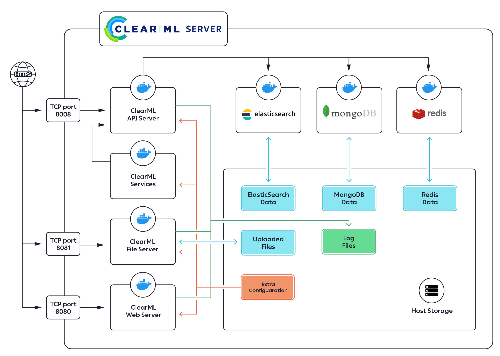

<div align="center">


**CairnML - Auto-Magical Suite of tools to streamline your ML workflow 
</br>Experiment Manager, ML-Ops and Data-Management**

[](https://img.shields.io/badge/license-SSPL-green.svg)
[](https://img.shields.io/badge/python-3.11-blue.svg)
[](https://img.shields.io/github/release-pre/cairnml/cairnml-server.svg)
[](https://artifacthub.io/packages/search?repo=cairnml)

</div>

## CairnML Server

The **CairnML Server** is the backend service infrastructure for [CairnML](https://github.com/cairnml/cairnml).
It allows multiple users to collaborate and manage their experiments.
**CairnML** offers a [free hosted service](https://app.clear.ml/), which is maintained by **CairnML** and open to anyone.
In order to host your own server, you will need to launch the **CairnML Server** and point **CairnML** to it.

The **CairnML Server** contains the following components:

* The **CairnML** Web-App, a single-page UI for experiment management and browsing
* RESTful API for:
    * Documenting and logging experiment information, statistics and results
    * Querying experiments history, logs and results
* Object storage (S3) for artifacts, datasets, models and debug images, served through the API server

You can quickly [deploy](#launching-the-cairnml-server)  your **CairnML Server** using Docker, AWS EC2 AMI, or Kubernetes. 

## System design




The **CairnML Server** has two supported configurations:
- Single IP (domain) with the following open ports
    - Web application on port 8080
    - API service on port 8008

- Sub-Domain configuration with default http/s ports (80 or 443)
    - Web application on sub-domain: app.\*.\*
    - API service on sub-domain: api.\*.\*
    
## Launching The CairnML Server

### Prerequisites

The ports 8080/8008 must be available for the **CairnML Server** services.
   
For example, to see if port `8080` is in use:

* Linux or macOS: 
   
        sudo lsof -Pn -i4 | grep :8080 | grep LISTEN

* Windows:

        netstat -an |find /i "8080"
   
### Launching   
    
Launch The **CairnML Server** in any of the following formats:

- Pre-built [AWS EC2 AMI](https://clear.ml/docs/latest/docs/deploying_clearml/clearml_server_aws_ec2_ami)
- Pre-built [GCP Custom Image](https://clear.ml/docs/latest/docs/deploying_clearml/clearml_server_gcp)
- Pre-built Docker Image
    - [Linux](https://clear.ml/docs/latest/docs/deploying_clearml/clearml_server_linux_mac)
    - [macOS](https://clear.ml/docs/latest/docs/deploying_clearml/clearml_server_linux_mac)
    - [Windows 10](https://clear.ml/docs/latest/docs/deploying_clearml/clearml_server_win)
- Kubernetes    
    - [Kubernetes Helm](https://clear.ml/docs/latest/docs/deploying_clearml/clearml_server_kubernetes_helm)
    - Manual [Kubernetes installation](https://clear.ml/docs/latest/docs/deploying_clearml/clearml_server_kubernetes)

## Connecting CairnML to your CairnML Server

In order to set up the **CairnML** client to work with your **CairnML Server**:
- Run the `cairnml-init` command for an interactive setup.
- Or manually edit `~/cairnml.conf` file, making sure the server settings (`api_server`, `web_server`) are configured correctly, for example:

        api {
            # API server on port 8008
            api_server: "http://localhost:8008"

            # web_server on port 8080
            web_server: "http://localhost:8080"
        }

**Note**: If you have set up your **CairnML Server** in a sub-domain configuration, then there is no need to specify a port number,
it will be inferred from the http/s scheme.

After launching the **CairnML Server** and configuring the **CairnML** client to use the **CairnML Server**,
you can [use](https://github.com/cairnml/cairnml) **CairnML** in your experiments and view them in your **CairnML Server** web server,
for example http://localhost:8080.  
For more information about the CairnML client, see [**CairnML**](https://github.com/cairnml/cairnml).

## CairnML-Agent Services  <a name="services"></a> 

As of version 0.15 of **CairnML Server**, dockerized deployment includes a **CairnML-Agent Services** container running as 
part of the docker container collection.

CairnML-Agent Services is an extension of CairnML-Agent that provides the ability to launch long-lasting jobs 
that previously had to be executed on local / dedicated machines. It allows a single agent to 
launch multiple dockers (Tasks) for different use cases. To name a few use cases, auto-scaler service (spinning instances 
when the need arises and the budget allows), Controllers (Implementing pipelines and more sophisticated DevOps logic),
Optimizer (such as Hyper-parameter Optimization or sweeping), and Application (such as interactive Bokeh apps for 
increased data transparency)

CairnML-Agent Services container will spin **any** task enqueued into the dedicated `services` queue. 
Every task launched by CairnML-Agent Services  will be registered as a new node in the system, 
providing tracking and transparency capabilities.  
You can also run the CairnML-Agent Services manually, see details in [CairnML-agent services mode](https://github.com/cairnml/cairnml-agent#cairnml-agent-services-mode-)

**Note**: It is the user's responsibility to make sure the proper tasks are pushed into the `services` queue. 
Do not enqueue training / inference tasks into the `services` queue, as it will put unnecessary load on the server.

## Advanced Functionality

The **CairnML Server** provides a few additional useful features, which can be manually enabled:
 
* [Web login authentication](https://clear.ml/docs/latest/docs/deploying_clearml/clearml_server_config#web-login-authentication)
* [Non-responsive experiments watchdog](https://clear.ml/docs/latest/docs/deploying_clearml/clearml_server_config#non-responsive-task-watchdog)  

## Restarting CairnML Server

To restart the **CairnML Server**, you must first stop the containers, and then restart them.

   ```bash
   docker-compose down
   docker-compose -f docker-compose.yml up
   ```

## Upgrading <a name="upgrade"></a>

**CairnML Server** releases are also reflected in the [docker compose configuration file](https://github.com/cairnml/cairnml-server/blob/master/docker/docker-compose.yml).  
We strongly encourage you to keep your **CairnML Server** up to date, by keeping up with the current release.

**Note**: The following upgrade instructions use the Linux OS as an example.

To upgrade your existing **CairnML Server** deployment:

1. Shut down the docker containers
   ```bash
   docker-compose down
   ```

1. We highly recommend backing up your data directory before upgrading.

   Assuming your data directory is `/opt/cairnml`, to archive all data into `~/cairnml_backup.tgz` execute:

   ```bash
   sudo tar czvf ~/cairnml_backup.tgz /opt/cairnml/data
   ```    

   <details>
   <summary>Restore instructions:</summary>

   To restore this example backup, execute:
   ```bash
   sudo rm -R /opt/cairnml/data
   sudo tar -xzf ~/cairnml_backup.tgz -C /opt/cairnml/data
   ```
   </details>

1. Download the latest `docker-compose.yml` file.

   ```bash
   curl https://raw.githubusercontent.com/cairnml/cairnml-server/master/docker/docker-compose.yml -o docker-compose.yml 
   ```

1. Configure the CairnML-Agent Services (not supported on Windows installation). 
   If `CAIRNML_HOST_IP` is not provided, CairnML-Agent Services will use the external 
   public address of the **CairnML Server**. If `CAIRNML_AGENT_GIT_USER` / `CAIRNML_AGENT_GIT_PASS` are not provided, 
   the CairnML-Agent Services will not be able to access any private repositories for running service tasks.
   
   ```bash
   export CAIRNML_HOST_IP=server_host_ip_here
   export CAIRNML_AGENT_GIT_USER=git_username_here
   export CAIRNML_AGENT_GIT_PASS=git_password_here
   ```

1. Spin up the docker containers, it will automatically pull the latest **CairnML Server** build    
   ```bash
   docker-compose -f docker-compose.yml pull
   docker-compose -f docker-compose.yml up
   ```

**\* If something went wrong along the way, check our FAQ: [Common Docker Upgrade Errors](https://clear.ml/docs/latest/docs/faq/).**


## Community & Support

If you have any questions, look to the CairnML [FAQ](https://clear.ml/docs/latest/docs/faq), or
tag your questions on [stackoverflow](https://stackoverflow.com/questions/tagged/cairnml) with '**cairnml**' tag.

For feature requests or bug reports, please use [GitHub issues](https://github.com/cairnml/cairnml-server/issues).

Additionally, you can always find us at *cairnml@allegro.ai*

## License

[Server Side Public License v1.0](https://github.com/mongodb/mongo/blob/master/LICENSE-Community.txt)

The **CairnML Server** relies on both [MongoDB](https://github.com/mongodb/mongo) and [ElasticSearch](https://github.com/elastic/elasticsearch).
With the recent changes in both MongoDB's and ElasticSearch's OSS license, we feel it is our responsibility as a
member of the community to support the projects we love and cherish.
We believe the cause for the license change in both cases is more than just,
and chose [SSPL](https://www.mongodb.com/licensing/server-side-public-license) because it is the more general and flexible of the two licenses.

This is our way to say - we support you guys!
