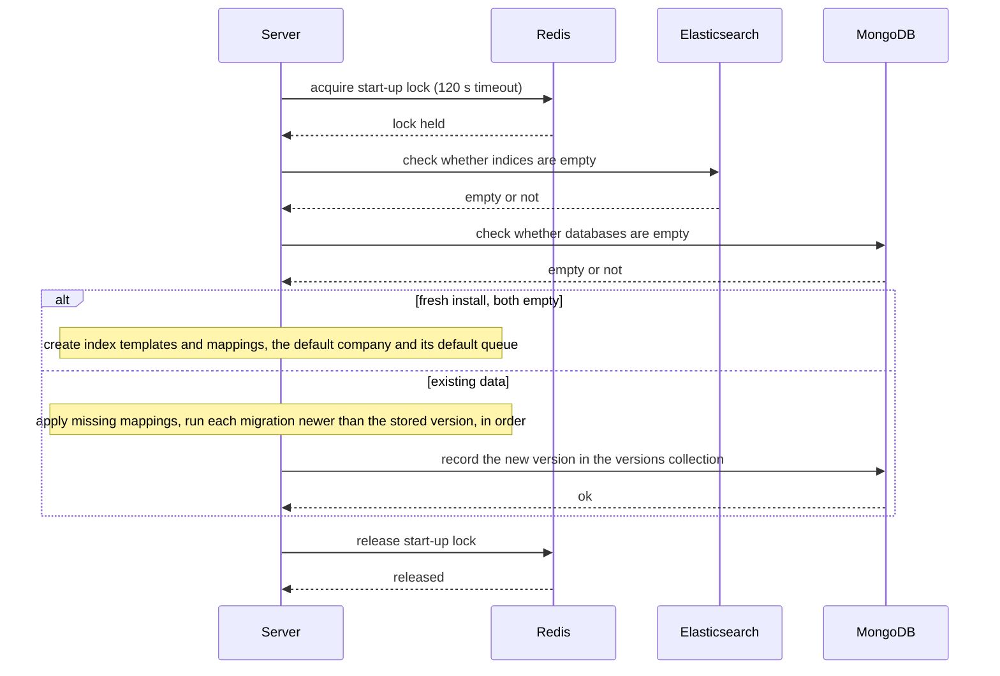
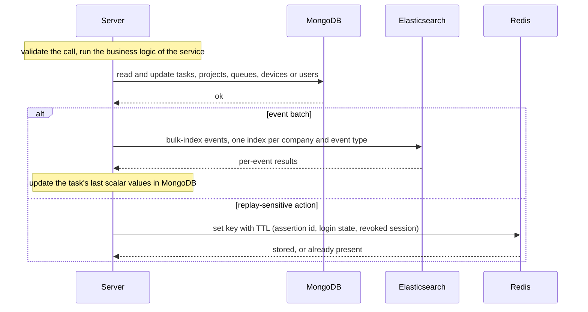
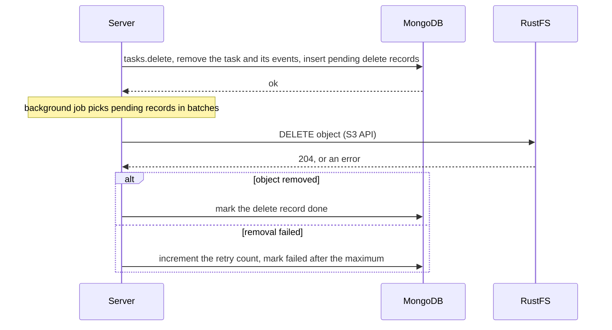
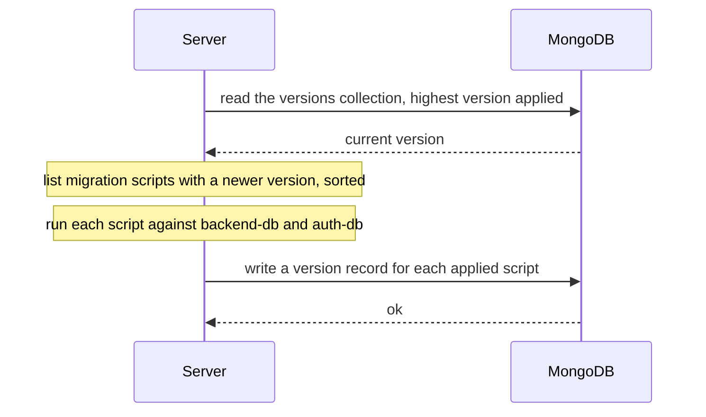

# Database management

The server keeps three stores:

- **MongoDB** with two databases: `backend-db` for tasks, models and projects, and `auth-db` for access records.
- **Elasticsearch** for event and metric indices.
- **Redis** for short-lived state (login state, single-use assertion ids, revoked sessions) and a lock for start-up.

Object bytes live in RustFS, never in a database.

## Start-up

Only one server instance runs start-up at a time, under a lock in Redis.

## Record writes

Writes are not in one transaction across the stores. A failure after one write leaves that write in place, and the client receives an error.

## Removing objects

Deleting a task removes its metadata at once. The stored objects are removed later by a background job, which retries failures.

Records that have failed stay in the database, so they can be retried.

## Migrations

Each release that changes stored data ships a migration script in `apiserver/mongo/migrations/`. Scripts run at start-up, and only when the databases already contain data. A fresh install is created directly at the current version.

Rolling back to an older server is not supported once a newer migration has run.
