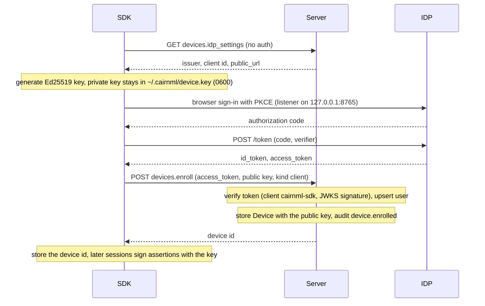
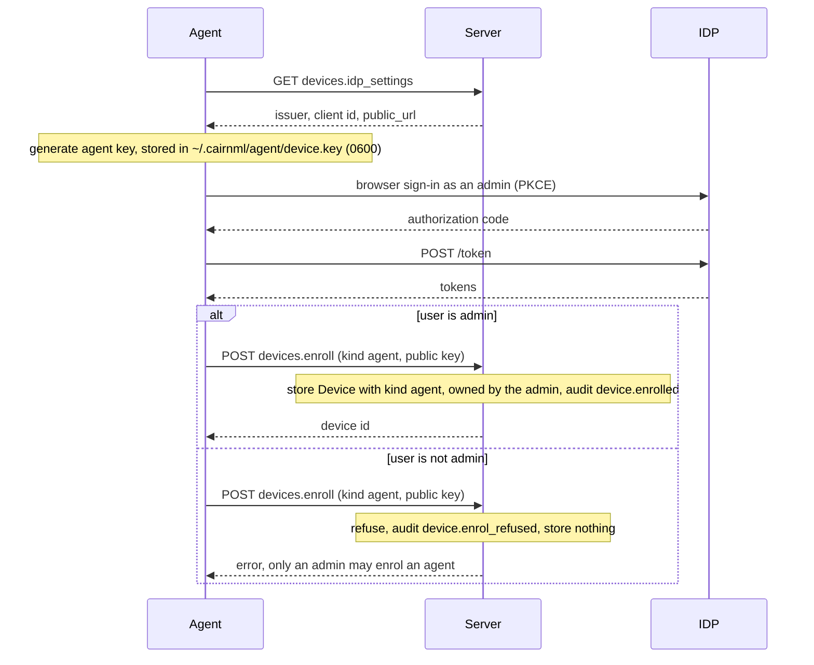

# Device enrolment

A machine signs in once, generates its own Ed25519 key, and registers the public key with the server. The private key never leaves the machine. The SDK (`cairnml init`) and the agent (`cairnml-agent init`) use the same handshake. They differ in the key they create and in who may enrol them.

## SDK machine

## Agent

The agent's key is stored in `~/.cairnml/agent/device.key`. The server accepts the enrolment only when the signed-in person is an admin, because an agent runs other people's jobs.

## Endpoints

| Endpoint | Auth | Purpose |
|---|---|---|
| `devices.idp_settings` | none | Returns the issuer and client id the machine needs for sign-in, and the address that device assertions must name |
| `devices.enroll` | identity-provider token | Stores the device's public key and owner. Agents need an admin |

## Notes

- The sign-in listener is fixed at `127.0.0.1:8765`, because the identity provider registers exactly that redirect address. On a machine without a browser this flow does not work yet (see the open issues on headless enrolment).
- `--force` revokes the previous device before enrolling again.
- The owner of a device stays the person who enrolled it. Their disabling stops every device they own (see [Trust model](trust-model.md)).
