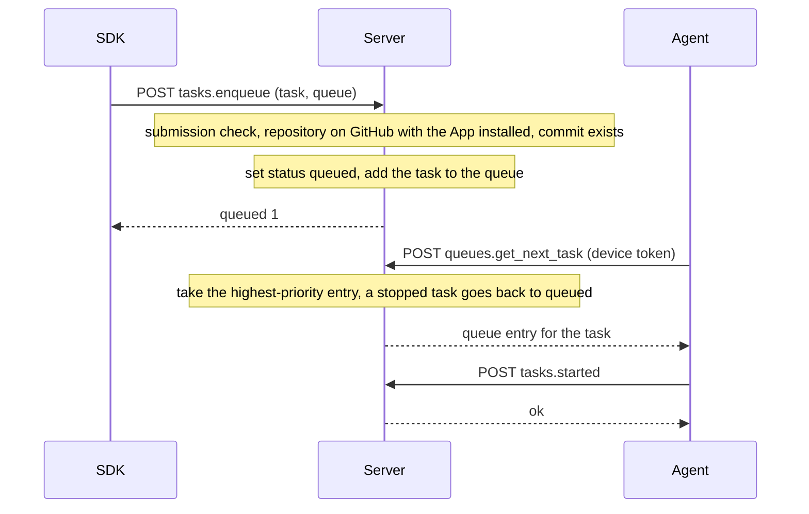
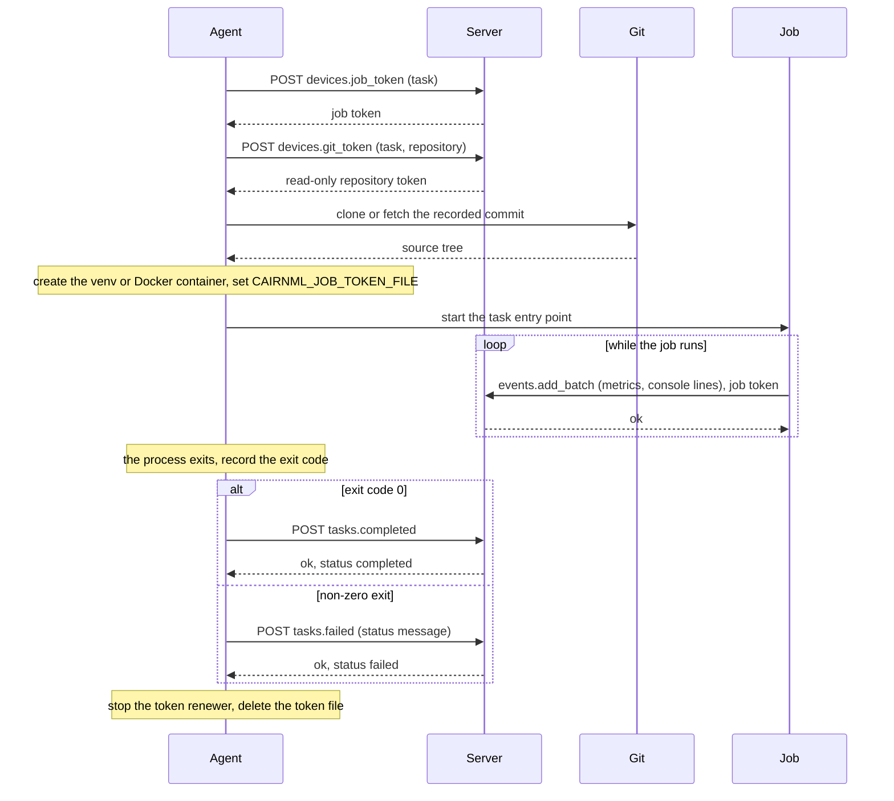
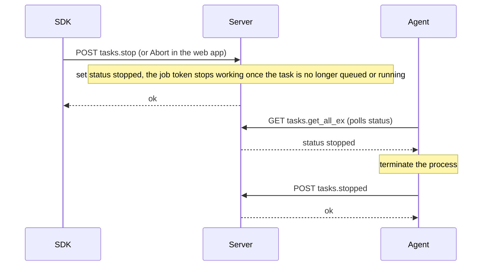

# Job execution

The SDK or the web app puts a task in a queue. An agent pulls it, obtains a job token for this run, fetches the source with a server-issued token, runs it and reports the result. The job itself never uses the agent's token.

## Enqueue and pull

## Run and report

## Abort

## Endpoints

| Endpoint | Caller | Purpose |
|---|---|---|
| `tasks.enqueue` | SDK, web app | Puts the task in a queue after the submission check |
| `queues.get_next_task` | agent | Takes the next task of a queue |
| `tasks.started` | agent | Marks the task as running on this agent |
| `devices.job_token` | agent | Issues the job token (see [Job tokens](job-tokens.md)) |
| `devices.git_token` | agent or job | Issues a read-only repository token |
| `events.add_batch` | job | Sends metrics and console lines |
| `tasks.completed`, `tasks.failed` | agent | Report the result |
| `tasks.stop` | SDK, web app | Asks the agent to stop the task |
| `tasks.stopped` | agent | Reports that the task was stopped |
| `tasks.get_all_ex` | agent | Reads the task status while polling |
