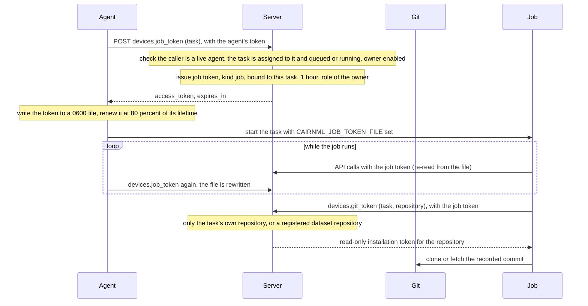

# Job tokens

A job never runs with the agent's own token. For each task the agent asks the server for a **job token**: a token that is bound to one task and expires with the job. The agent keeps it renewed while the job runs. The job reads it from a file.

## Renewal

The agent renews at 80 percent of the lifetime. If a renewal fails for a network reason it tries again after 30 seconds. If the server refuses the renewal, the task has ended and the agent stops renewing.

## Endpoints

| Endpoint | Caller | Purpose |
|---|---|---|
| `devices.job_token` | agent | Issues a job token for a task the agent is running |
| `devices.git_token` | job or agent | Issues a read-only repository token. A job gets only its own task's repository, or a registered dataset repository |

## Limits

A job token acts as the task's owner: it has the owner's role, not a role limited to the task. Its lifetime is one hour, and it works only while the task is queued or running. See [Trust model](trust-model.md).
