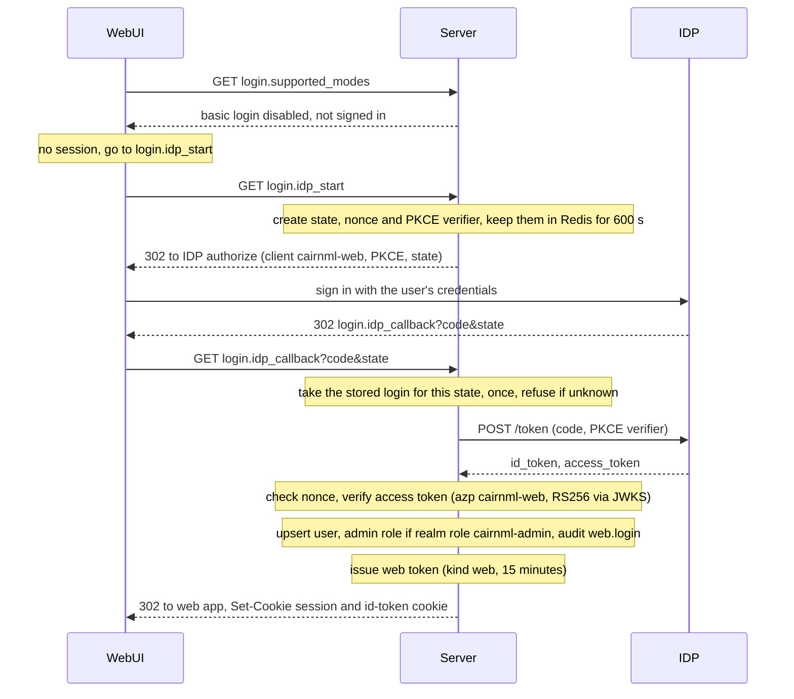
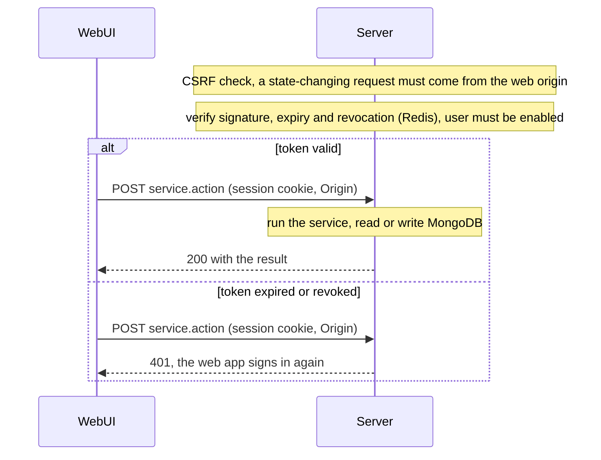
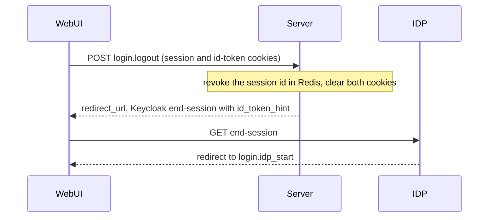

# Sign-in

The web app holds no credential of its own. The browser is sent to the identity provider (Keycloak, realm `cairnml`). When the sign-in comes back, the server sets an HttpOnly session cookie. A second cookie holds the ID token and is sent only to the logout endpoint.

## Sign-in with PKCE

## Authenticated request

## Logout

Without the id-token hint Keycloak asks the person to confirm the logout, so the cookie is kept for that call.

## Endpoints

| Endpoint | Purpose |
|---|---|
| `login.supported_modes` | Tells the web app that only the identity provider is used |
| `login.idp_start` | Starts a sign-in: creates state and PKCE values and redirects to Keycloak |
| `login.idp_callback` | Completes the sign-in: exchanges the code, checks the token, sets the cookies |
| `login.logout` | Ends the CairnML session and returns the Keycloak end-session URL |

## Cookies

| Cookie | Attributes | Purpose |
|---|---|---|
| `cairnml_token_basic` | HttpOnly, SameSite=Strict, path `/cairnml` | The web session token |
| `cairnml_idp_session` | HttpOnly, SameSite=Strict, path `/cairnml/api/v999.0/login.logout` | The ID token, sent only to logout |
