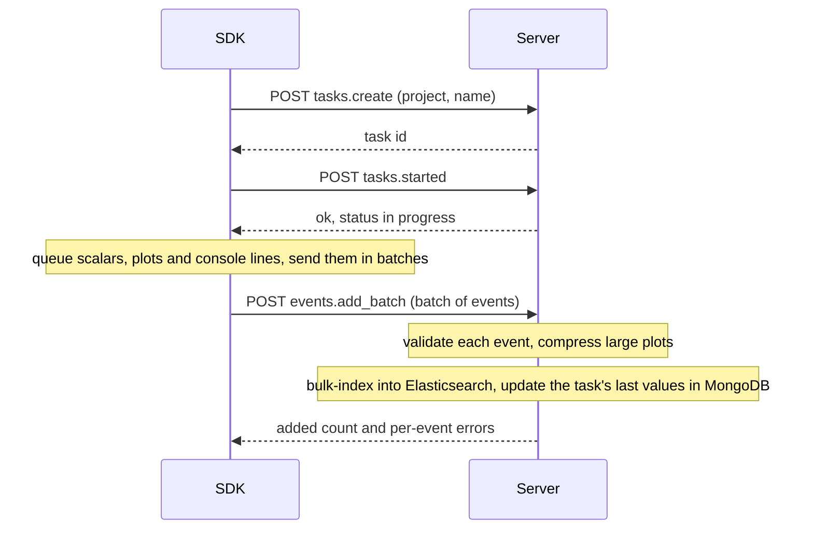
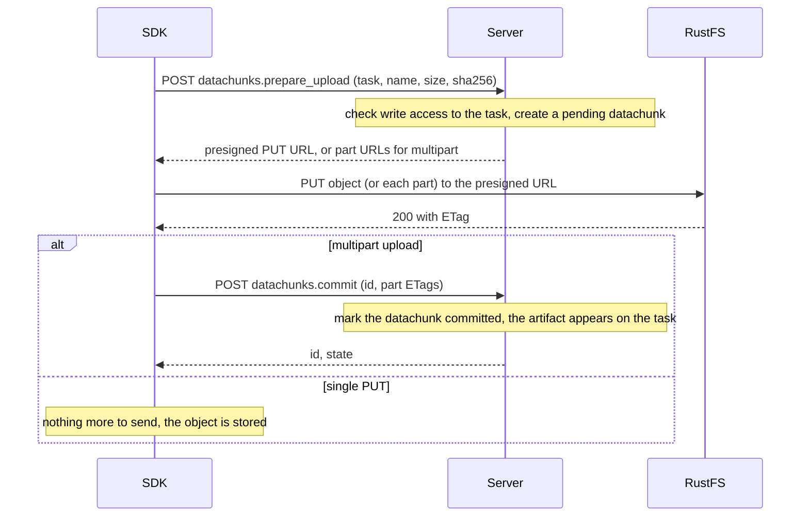

# Task logging

A running script sends its metrics, plots and console output to the server in batches. Large files do not pass through the API. The server returns a presigned URL, and the SDK uploads the file straight to object storage (RustFS).

## Events

## Artifacts

## Notes

- The server records the sha256 that the SDK declared when it prepared the upload. It never holds the file bytes.
- Console output uses the same `events.add_batch` call, as the `log` event type, and appears on the task's Console tab.
- Presigned URLs are valid for 15 minutes.

## Endpoints

| Endpoint | Purpose |
|---|---|
| `events.add_batch` | Stores a batch of metrics, plots and console lines |
| `datachunks.prepare_upload` | Creates the datachunk and returns the presigned URL(s) |
| `datachunks.commit` | Completes a multipart upload |
