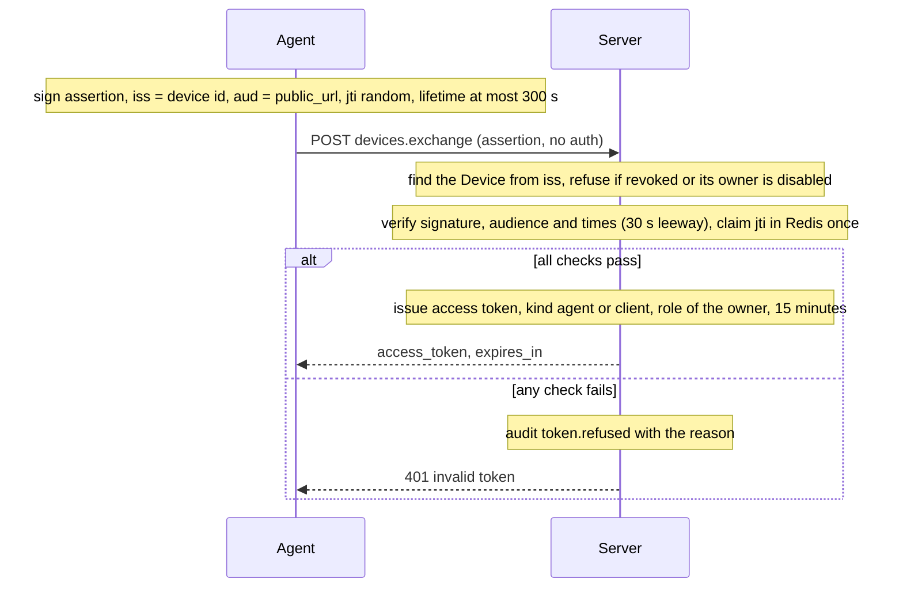

# Token exchange

Every SDK or agent session turns its device key into a short-lived access token. The device proves that it holds the key by signing a short assertion. The server checks the assertion and issues a token that carries the owner's role. Each assertion can be used once.

## Why a signed assertion

The device key is never sent over the network. An assertion is bound to one server address (`aud`), so a copy captured on the way to another server is useless there. The `jti` value is stored in Redis for the assertion's lifetime, so a replayed assertion is refused.

## Endpoint

| Endpoint | Auth | Purpose |
|---|---|---|
| `devices.exchange` | assertion only | Issues an access token for a live device |

## What the token carries

| Claim | Value |
|---|---|
| `kind` | `client` (SDK) or `agent` |
| `device` | the device id |
| `identity` | the owner's user id, company and role |
| `exp` | 15 minutes after issue |

Revoking a device or disabling its owner stops new exchanges at once. A token already issued stays valid until it expires, at most 15 minutes.
